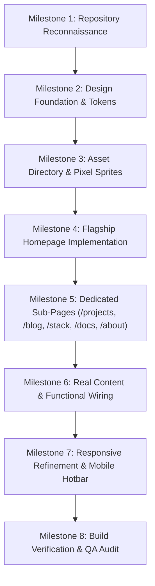

# AGENTS.md — Master Architecture Blueprint & Execution Playbook
> **Project:** Manish.dev — The Builder's World (Minecraft Developer Portfolio)  
> **Target Execution Agent:** Antigravity / Gemini 3.8 Flash  
> **Visual Reference:** Reference Screenshot (2D Minecraft-Inspired Developer Dashboard)  
> **Status:** Production-Ready Planning Specification (Phases 1–9 Complete)  

---

## 🧭 Executive Summary & Non-Negotiable Directives

This document serves as the **single source of truth** for Antigravity (powered by Gemini 3.8 Flash) to implement **Manish.dev**. 

### The Core Mandate
Build a **2D Minecraft-inspired developer portfolio** that looks visually stunning, handcrafted, and atmospheric like the supplied reference screenshot, while maintaining the rigorous software engineering standards, discoverability, and accessibility of a senior developer's web platform.

```
       +-----------------------------------------------------------+
       |               LAYER 1: VISUAL ATMOSPHERE                  |
       |  Minecraft Twilight Forest, Dark Oak Bevels, Lantern Glow |
       +-----------------------------------------------------------+
                                    |
                                    v
       +-----------------------------------------------------------+
       |             LAYER 2: AUTHENTIC WEB ENGINE                 |
       |  Next.js 14+ App Router, Tailwind CSS, TypeScript, MDX    |
       +-----------------------------------------------------------+
                                    |
                                    v
       +-----------------------------------------------------------+
       |              LAYER 3: CREDIBLE ENGINEERING                |
       |  Real Projects (Locus AI, CohortX, Smart Fan IoT), Guides |
       +-----------------------------------------------------------+
```

### 🚫 Non-Negotiable Guardrails (Anti-Patterns)
1. **NO 3D Canvas / Three.js Overhead:** The website is strictly a **2D experience**. Do NOT install Three.js, React Three Fiber, or 3D physics engines for the primary layout. The look is achieved via layered WebP pixel art, CSS grid, and Minecraft-style beveled panels.
2. **NO AI Slop / Generic Templates:** No generic neon gradients, no unreadable cyan glassmorphism, no fake terminal typing animations, and no fabricated proficiency percentages (e.g., "React 95%").
3. **NO Unreadable Pixelated Body Text:** Pixel fonts (`Pixelify Sans`, `Press Start 2P`) are strictly reserved for headings, buttons, and badges. Long-form articles, case studies, and documentation must use clean, highly legible typefaces (`Inter` or `Geist`).
4. **NO Flattened Mockup Images:** Every panel, card, button, tag, and link must be a real, accessible HTML/CSS DOM element with functional routing and keyboard navigation.
5. **NO Fabricated Content or Broken Links:** All projects, blog posts, short updates, videos, and documentation must reflect real engineering work with functioning routes and verified external URLs.

---

## 📑 Planning Document Index

All 9 detailed phase specifications are modularized and available in `docs/agent_phases/`:

| Phase | Phase Title | Document Link | Core Focus |
| :---: | :--- | :--- | :--- |
| **01** | **Product Vision & Scope** | [`PHASE_01_PRODUCT_VISION.md`](file:///c:/Users/manis/OneDrive/Documents/minecraft-protfolio/docs/agent_phases/PHASE_01_PRODUCT_VISION.md) | Audience analysis, success metrics, content pillars, anti-patterns. |
| **02** | **Information Architecture** | [`PHASE_02_INFORMATION_ARCHITECTURE.md`](file:///c:/Users/manis/OneDrive/Documents/minecraft-protfolio/docs/agent_phases/PHASE_02_INFORMATION_ARCHITECTURE.md) | Full route topology, sitemap, entity relations, responsive reflow. |
| **03** | **Visual Design System** | [`PHASE_03_VISUAL_DESIGN_SYSTEM.md`](file:///c:/Users/manis/OneDrive/Documents/minecraft-protfolio/docs/agent_phases/PHASE_03_VISUAL_DESIGN_SYSTEM.md) | Color tokens, Minecraft bevels, typography scale, buttons, tags. |
| **04** | **Visual Asset Matrix** | [`PHASE_04_ASSET_PRODUCTION_MATRIX.md`](file:///c:/Users/manis/OneDrive/Documents/minecraft-protfolio/docs/agent_phases/PHASE_04_ASSET_PRODUCTION_MATRIX.md) | Asset file manifest, resolutions, formats, Gemini image prompts. |
| **05** | **Page-by-Page Specifications** | [`PHASE_05_PAGE_BY_PAGE_SPECIFICATIONS.md`](file:///c:/Users/manis/OneDrive/Documents/minecraft-protfolio/docs/agent_phases/PHASE_05_PAGE_BY_PAGE_SPECIFICATIONS.md) | Detailed DOM layout for Home, Projects, Blog, Tweets, Films, Stack. |
| **06** | **Technical Architecture** | [`PHASE_06_TECHNICAL_ARCHITECTURE.md`](file:///c:/Users/manis/OneDrive/Documents/minecraft-protfolio/docs/agent_phases/PHASE_06_TECHNICAL_ARCHITECTURE.md) | Next.js App Router, TypeScript schemas, MDX engine, performance. |
| **07** | **Interactions & Animations** | [`PHASE_07_INTERACTIONS_AND_ANIMATION.md`](file:///c:/Users/manis/OneDrive/Documents/minecraft-protfolio/docs/agent_phases/PHASE_07_INTERACTIONS_AND_ANIMATION.md) | Hanging sign physics, inventory tooltips, Web Audio synth, a11y. |
| **08** | **Antigravity Implementation** | [`PHASE_08_ANTIGRAVITY_IMPLEMENTATION_PLAN.md`](file:///c:/Users/manis/OneDrive/Documents/minecraft-protfolio/docs/agent_phases/PHASE_08_ANTIGRAVITY_IMPLEMENTATION_PLAN.md) | Milestone-by-milestone instructions, step-by-step commands. |
| **09** | **QA & Final Sign-Off** | [`PHASE_09_QUALITY_ASSURANCE_AND_HANDOFF.md`](file:///c:/Users/manis/OneDrive/Documents/minecraft-protfolio/docs/agent_phases/PHASE_09_QUALITY_ASSURANCE_AND_HANDOFF.md) | Visual comparison audit against reference screenshot, performance checks. |

---

## 🖼️ Reference Screenshot Breakdown

The layout directly replicates the user's provided visual screenshot:

```
+=======================================================================================================+
| [NAVBAR] <Manish.dev>   [Home] [About] [Projects] [Blog] [Tweets] [Films] [Stack] [Docs]  [Let's Connect]
+=======================================================================================================+
| [HERO REGION: Twilight Pixel Forest Panorama, Cliff, Waterfall, Lantern, Sitting Character]           |
|                                                                                                       |
|  Hey, I'm                                                       [HANGING WOODEN SIGNS (Iron Chains)]  |
|  Manish Kumar                                                    - [⛏️] Build Projects               |
|  B.Tech CSE (IoT) @ NIET                                         - [🪶] Write & Share                |
|  Building real projects, learning in public, and cool stuff.     - [📖] Learn & Document             |
|                                                                  - [🧭] Open Source                  |
|  [🟩 View My Work ->]   [🪵 Read My Blog]                        - [📦] Keep Exploring               |
+=======================================================================================================+
| [MIDDLE REGION: 3/4 Width Featured Projects + 1/4 Width About Me Sidebar]                             |
| +----------------------------------------------------------------+ +--------------------------------+ |
| | [FEATURED PROJECTS]                             View All ->    | | [ABOUT ME]                     | |
| | +----------------+ +----------------+ +----------+ +---------+ | | [Avatar] Manish CSE (IoT)      | |
| | | Locus (AI)     | | CohortX        | | SmartFan | | 3D Port | | | [22 Yrs] [CSE NIET] [🇮🇳 India] | |
| | | Next/Prisma/PG | | React/Node/PG  | | ESP/DHT  | | ThreeJS | | | [🟩 More About Me ->]          | |
| | +----------------+ +----------------+ +----------+ +---------+ | |                                | |
| +----------------------------------------------------------------+ +--------------------------------+ |
+=======================================================================================================+
| [LOWER REGION: 4-Column Balanced Grid]                                                                |
| +--------------------+ +--------------------+ +--------------------+ +------------------------------+ |
| | [LATEST BLOG POSTS]| | [LATEST TWEETS]    | | [FILMS / DEMOS]    | | [TECH STACK INVENTORY]       | |
| | - How I Built Locus| | - Pushed AI feature| | - Locus Walkthrough| | [Next] [React] [Node] [Pris] | |
| | - Next.js + Neon PG| | - 3D Portfolio fun | | - CohortX Deep Dive| | [TS]   [Tail]  [Dock] [ESP8] | |
| | - IoT Journey      | | - Keep building!   | | - Smart Fan IoT Demo| | [Py]   [Git]   [Lin]  [Three]| |
| +--------------------+ +--------------------+ +--------------------+ +------------------------------+ |
+=======================================================================================================+
| [FOOTER: Oak Frame, GitHub, LinkedIn, Twitter, Email, RSS Feed, Return to Spawn Point]                |
+=======================================================================================================+
```

---

## 🎨 Visual Design System & CSS Tokens

```css
:root {
  /* Environmental Backgrounds */
  --color-sky-deep: #101e37;
  --color-forest-dark: #1b3824;
  --color-forest-accent: #254b32;

  /* UI Frame & Wooden Surfaces */
  --color-wood-border-dark: #30251d;    /* Outer dark oak bevel */
  --color-wood-frame: #493421;          /* Primary wooden border */
  --color-wood-highlight: #6b4d32;      /* Top-left lit bevel */
  --color-wood-shadow: #221811;         /* Bottom-right shadow bevel */

  /* Inset Content Surfaces */
  --color-panel-bg: #1c1b19;            /* Main dark panel surface */
  --color-card-bg: #252320;             /* Inset card surface */
  --color-card-border: #38342e;         /* Inset card border */
  --color-slot-bg: #141312;             /* Inventory slot interior */

  /* Interactive Accents */
  --color-emerald-primary: #36c653;     /* Minecraft green button */
  --color-emerald-hover: #42df64;       /* Green button hover */
  --color-emerald-shadow: #1e7a33;      /* Green button 3D bottom bevel */
  --color-emerald-soft: #8de6a0;        /* Active tabs & glowing borders */
  --color-lantern-gold: #f5c66b;        /* Gold arrows, stars & highlights */
  --color-stone-border: #77736d;        /* Stone / iron border accent */

  /* Typography */
  --color-text-title: #f4f0e8;          /* Warm white for headers */
  --color-text-body: #d2cbbf;           /* Highly legible body text */
  --color-text-muted: #8e8a82;          /* Timestamps & subtitles */
  --color-text-inverse: #141312;        /* Dark text on bright buttons */
}

/* Authentic Minecraft Wooden Panel */
.mc-panel-wood {
  background-color: var(--color-panel-bg);
  border: 4px solid var(--color-wood-frame);
  box-shadow: 
    inset 2px 2px 0px 0px var(--color-wood-highlight),
    inset -2px -2px 0px 0px var(--color-wood-shadow),
    0px 4px 12px rgba(0, 0, 0, 0.65);
  border-radius: 4px;
}

/* Authentic Minecraft Inset Card */
.mc-card-inset {
  background-color: var(--color-card-bg);
  border: 2px solid var(--color-card-border);
  box-shadow: 
    inset 2px 2px 0px 0px rgba(0, 0, 0, 0.5),
    inset -1px -1px 0px 0px rgba(255, 255, 255, 0.08);
  border-radius: 3px;
}
```

---

## 🧱 Data Models & Schema Contracts

```typescript
// 1. Project Entity (src/data/projects.ts)
export interface Project {
  slug: string;
  title: string;
  tagline: string;
  category: 'web' | 'iot' | 'ai' | 'fullstack';
  featured: boolean;
  coverImage: string;
  tags: string[];
  githubUrl?: string;
  liveUrl?: string;
  caseStudy: {
    problem: string;
    solution: string;
    architectureDiagram: string;
    keyChallenges: string[];
    hardwarePinout?: string[];
    lessonsLearned: string[];
  };
}

// 2. Blog Post Entity (src/data/blog.ts)
export interface BlogPost {
  slug: string;
  title: string;
  summary: string;
  publishedAt: string;
  readingTime: string;
  thumbnail: string;
  tags: string[];
  featured: boolean;
  relatedProjectSlug?: string;
}

// 3. Short Update / Tweet Entity (src/data/tweets.ts)
export interface Tweet {
  id: string;
  content: string;
  relativeTime: string; // "2h ago", "1d ago"
  relatedProjectSlug?: string;
}

// 4. Video / Film Entity (src/data/films.ts)
export interface Film {
  slug: string;
  title: string;
  subtitle: string;
  duration: string; // "12 min"
  thumbnail: string;
  videoUrl: string;
  relatedProjectSlug: string;
}

// 5. Tech Stack Inventory Item (src/data/stack.ts)
export interface StackItem {
  id: string;
  name: string;
  category: 'frontend' | 'backend' | 'database' | 'iot' | 'tools';
  iconSvg: string;
  experienceYears: number;
  proficiencyLevel: 'Expert' | 'Advanced' | 'Proficient';
  projectsUsedIn: string[];
}
```

---

## 🚀 Autonomous Milestone Execution Playbook

Antigravity must follow this ordered 8-milestone workflow without jumping ahead:



### Milestone 1: Repository Reconnaissance & Setup
1. Inspect the workspace. If no `package.json` exists, scaffold Next.js 14+:
   ```powershell
   npx -y create-next-app@latest ./ --typescript --tailwind --eslint --app --src-dir=false --import-alias="@/*" --use-npm
   ```
2. Verify package scripts and dependencies.

### Milestone 2: Design Foundation & CSS Tokens
1. Install fonts (`Pixelify Sans` and `Inter`) in `app/layout.tsx`.
2. Configure all CSS variables, border classes, and button styles in `app/globals.css`.
3. Create core atomic UI primitives in `components/ui/`:
   - `McPanel.tsx`
   - `McButton.tsx`
   - `Navbar.tsx`
   - `Footer.tsx`

### Milestone 3: Asset Scaffolding
1. Create directories: `public/images/hero/`, `public/images/projects/`, `public/images/blog/`, `public/images/films/`, `public/icons/nav/`, `public/icons/stack/`.
2. Populate SVG icons and WebP pixel-art artwork matching Phase 4.

### Milestone 4: Flagship Homepage Dashboard
1. Implement `HeroSection.tsx` with twilight background, seated character, extruded 3D typography, and dual CTAs.
2. Implement `HangingSigns.tsx` with suspended iron chains and pendulum sway animation.
3. Implement `FeaturedProjects.tsx` (3/4 width) featuring Locus, CohortX, Smart Fan, and 3D Portfolio.
4. Implement `AboutMePanel.tsx` (1/4 width) with avatar, bio, 3 stat boxes (`22 Years`, `CSE (IoT) NIET`, `India`), and green CTA.
5. Implement the 4 lower panels:
   - `LatestBlogPanel.tsx` (3 articles)
   - `LatestTweetsPanel.tsx` (3 short updates)
   - `FilmsPanel.tsx` (3 video cards with play overlay)
   - `TechStackPanel.tsx` (5x3 inventory matrix with purple Minecraft lore tooltips)
6. Visually inspect against the reference screenshot.

### Milestone 5: Sub-Routes & Deep Case Studies
1. `/projects` and `/projects/[slug]` (Interactive architecture diagram, problem, solution, IoT pinout).
2. `/blog` and `/blog/[slug]` (Bookshelf library styling, syntax-highlighted code, TOC).
3. `/tweets` (Town Square notice board).
4. `/films` (Cinema room with video playback modal).
5. `/stack` (Crafting table + inventory room with category filters).
6. `/docs` (Technical setup guides and API notes).
7. `/about`, `/contact`, `/resume` (Player profile and verified resume download).

### Milestone 6: Functional Wiring & State
1. Connect all routes, search filters, category selectors, and video modal triggers.
2. Implement zero-dependency `SoundService.ts` using the Web Audio API for tactile button clicks (`click-wood`) and inventory hover pops (`pop-item`).

### Milestone 7: Responsive Refinement
1. Test desktop (1440px): 4 project cards in one row, 4 lower panels in one row.
2. Test tablet (768px–1024px): 2x2 projects grid, 2x2 lower panels.
3. Test mobile (<768px): Single-column stacked cards, comfortable tap targets (min 44x44px), compact navigation drawer.

### Milestone 8: Build Verification & Acceptance Sign-Off
1. Run `npm run build` to verify zero TypeScript or lint errors.
2. Verify all 8 navigation tabs route properly.
3. Verify Lighthouse scores: Performance > 90, Accessibility > 95, CLS < 0.05.
4. Compare rendered output with the reference screenshot for exact visual fidelity.

---

## 🎯 Final Definition of Done (DoD)

The portfolio is complete **only when**:
- [x] All 9 planning phases are codified in `docs/agent_phases/` and summarized in `AGENTS.md`.
- [ ] Next.js app boots cleanly on `npm run dev` and builds on `npm run build`.
- [ ] Homepage layout visually and structurally mirrors the reference screenshot.
- [ ] All project case studies, blog articles, tweets, films, and documentation contain real, credible engineering content.
- [ ] Responsive navigation and touch interactions function smoothly across mobile, tablet, and desktop viewports.

<!-- BEGIN:nextjs-agent-rules -->

## This is NOT the Next.js you know

This version has breaking changes — APIs, conventions, and file structure may all differ from your training data. Read the relevant guide in `node_modules/next/dist/docs/` (resolved from this file's directory; in monorepos the `next` package may not be visible from the repo root) before writing any code. Heed deprecation notices.

This block is written and re-added by `next dev` — verify at `node_modules/next/dist/server/lib/generate-agent-files.js`. Removing it from a diff only re-creates the uncommitted change; committing it with your work keeps the tree clean.

<!-- END:nextjs-agent-rules -->
