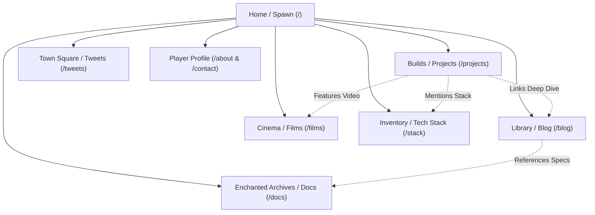

# Phase 1: Product Vision, Scope & Boundaries
> **Document ID:** AGENT-PHASE-01  
> **Target Project:** Manish.dev — The Builder's World (Minecraft Developer Portfolio)  
> **Status:** Approved Baseline  
> **Target Engine:** Antigravity / Gemini 3.8 Flash  

---

## 1.1 Executive Vision

**Manish.dev** is a high-performance, responsive personal developer portfolio engineered with the visual identity and atmosphere of a Minecraft 2D world, while maintaining the rigorous software engineering standards, discoverability, and accessibility of a senior developer's web platform.

```
       +-----------------------------------------------------------+
       |                  VISUAL IDENTITY LAYER                    |
       |  Minecraft-inspired 2D Pixel Art, Oak Bevels, Lantern Glow |
       +-----------------------------------------------------------+
                                    |
                                    v
       +-----------------------------------------------------------+
       |                 ENGINEERING REALITY LAYER                 |
       | Next.js App Router, SSR, MDX Case Studies, Clean Typeface |
       +-----------------------------------------------------------+
                                    |
                                    v
       +-----------------------------------------------------------+
       |                  CONTENT & PROOF LAYER                    |
       |  Locus (AI), CohortX, Smart Fan (IoT), Systems Architecture|
       +-----------------------------------------------------------+
```

### Core Tenet: "Game Aesthetics, Senior Engineering Reality"
- **No AI Slop:** No generic neon gradients, no meaningless glassmorphism, no fake terminal prompts, no fake progress percentages (e.g. "React: 94%").
- **Real Engineering Depth:** Every project card leads to an exhaustive case study detailing the technical problem, architecture diagram, stack choices, engineering trade-offs, performance benchmarks, and GitHub source code.
- **2D World, Not a Heavy 3D Game:** Avoid heavy WebGL/Three.js runtimes that drain battery or create slow initial page loads. The experience is delivered via optimized CSS layout, pixel-art sprite sheets, WebP environmental layers, and crisp typography.

---

## 1.2 Target Audience & UX Priorities

| Audience | Primary Goals | Key Website Surface | Critical Success Metric |
| :--- | :--- | :--- | :--- |
| **Recruiters & Tech Leads** | Quickly verify Manish's real technical abilities, education (B.Tech CSE IoT @ NIET), core stack, and contact options. | Hero quick stats, Featured Projects grid, downloadable Resume button (`/resume`), direct LinkedIn & GitHub links. | Reaches project repos or resume within **2 clicks** (< 5 seconds). |
| **Fellow Engineers & Reviewers** | Scrutinize code architecture, read real technical decisions, inspect hardware-software IoT bridges, and evaluate code quality. | Case studies (`/projects/[slug]`), Engineering Journal (`/blog/[slug]`), Knowledge Base (`/docs`). | Interactive architecture diagrams, clean code blocks with syntax highlighting, live deployment links. |
| **Tech Community & Visitors** | Experience a memorable, delightful, and handcrafted web atmosphere with cohesive easter eggs and micro-interactions. | Hanging wooden signboards, sound toggle (optional 8-bit click sounds), Twitter feed, Video walkthrough cinema. | High engagement, zero layout shift (CLS = 0), sub-second page loads. |

---

## 1.3 Core Content Pillars



1. **Builds (Projects):** Flagship software & IoT engineering products:
   - **Locus:** AI-Powered Real Estate Platform (Next.js, Prisma, Neon PostgreSQL, OpenAI API).
   - **CohortX:** Social platform for developer project collaboration (React, Node.js, Express, PostgreSQL).
   - **Smart Fan (IoT):** Hardware-software embedded fan automation (ESP8266 NodeMCU, DHT11 sensor, MQTT/WebSockets).
   - **3D Interactive Portfolio (WIP):** Future WebGL playground.
2. **Library (Blog / Build Logs):** Deep technical postmortems, architecture breakdowns, setup guides with Neon Postgres, and embedded hardware tutorials.
3. **Town Square (Tweets / Micro-thoughts):** Real-time thoughts, shipping milestones, experiment logs, and quick tips without third-party X/Twitter API dependencies.
4. **Cinema (Project Films & Demos):** Recorded walkthroughs, Loom video embeds, architecture screen captures, and live product demos.
5. **Inventory (Tech Stack):** Categorized Minecraft inventory grid with active item tooltips, usage evidence, and links to projects using each technology.
6. **Documentation (Knowledge Base):** Reusable cheat sheets, wiring diagrams, API contracts, and starter templates.

---

## 1.4 Non-Negotiable Guardrails (Anti-Patterns)

- ❌ **No 3D Three.js canvas overhead for the homepage:** The core UI must render immediately via pure HTML/CSS and WebP textures.
- ❌ **No pixelated unreadable body text:** Pixel fonts (`Press Start 2P`, `Pixelify Sans`) are restricted exclusively to headers, small badges, and numeric labels. Long-form articles and technical descriptions must use high-legibility fonts (`Inter` / `Geist`).
- ❌ **No single flattened image mockup:** The interface must not be a static image. Every panel, card, button, tag, and link must be an authentic, accessible DOM element.
- ❌ **No fake metric bars:** Avoid "JavaScript: 90%". Instead, display items like inventory slots with "2+ Years / 4 Shipped Builds".
