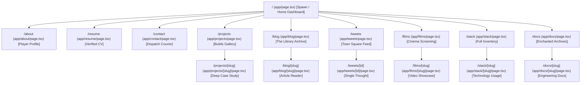
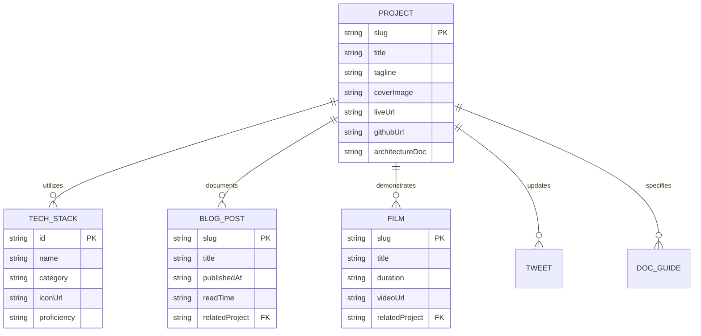

# Phase 2: Information Architecture & Route Topology
> **Document ID:** AGENT-PHASE-02  
> **Target Project:** Manish.dev — The Builder's World  
> **Status:** Approved Baseline  
> **Target Engine:** Antigravity / Gemini 3.8 Flash  

---

## 2.1 Complete Route Topology & Directory Hierarchy

The project implements Next.js App Router with semantic, permanent URLs. Every section functions as both an explorable Minecraft zone and a modern web service.



---

## 2.2 Global Navigation Architecture (`Navbar.tsx`)

The navigation bar sits anchored at the top of every public route, styled as a polished dark oak block panel with gold accents and authentic 16x16 pixel iconography.

### Desktop Navigation Layout (Width: 100%, Max-Width: 1440px)
```
+--------------------------------------------------------------------------------------------------------------------------+
| <Manish.dev>  | [🏠 Home] [🧑 About] [⛏️ Projects] [📜 Blog] [🪶 Tweets] [📽️ Films] [🧰 Stack] [📖 Docs] | [💎 Let's Connect ->] |
+--------------------------------------------------------------------------------------------------------------------------+
```

### Component Breakdown
| Element | Visual Asset | Target Route | Interactive State Behavior |
| :--- | :--- | :--- | :--- |
| **Brand Logo** | Pixel Font `<Manish.dev>` | `/` | Subtle golden glow on hover; instant client-side route reset. |
| **Home Tab** | 16x16 Pixel House/Crafting Icon | `/` | Active underline indicator with glowing emerald dot (`#36C653`). |
| **About Tab** | 16x16 Pixel Avatar Head | `/about` | Brightens border from `#30251D` to `#8DE6A0` on hover. |
| **Projects Tab** | 16x16 Diamond Pickaxe Icon | `/projects` | Active state retains inset oak background `#252320`. |
| **Blog Tab** | 16x16 Book & Quill Icon | `/blog` | Displays unread post count badge when new content is published. |
| **Tweets Tab** | 16x16 Pixel Feather Icon | `/tweets` | Dynamic pulse indicator when a tweet is posted within 24h. |
| **Films Tab** | 16x16 Pixel Clapperboard Icon | `/films` | Hover exposes tooltip: "Project Demos & Walkthroughs". |
| **Stack Tab** | 16x16 Crafting Table Icon | `/stack` | Opens inventory view with 3D block inspection. |
| **Docs Tab** | 16x16 Enchanted Tome Icon | `/docs` | Direct link to technical notes, wiring schematics & cheat sheets. |
| **Let's Connect CTA** | 16x16 Emerald Jewel Icon | `/contact` | High-contrast green button (`#36C653`) with oak border, bevel shadow. |

---

## 2.3 Home Page ("Spawn") Layout Architecture

The homepage is structured strictly according to the reference blueprint, prioritizing a high-density dashboard over an empty scroll journey.

```
+=======================================================================================================+
| [NAVBAR] <Manish.dev>    Home  About  Projects  Blog  Tweets  Films  Stack  Docs      [Let's Connect]  |
+=======================================================================================================+
| [HERO REGION: Twilight Pixel Forest, Cliff, Waterfall, Lantern, Sitting Character]                     |
|                                                                                                       |
|  Hey, I'm                                                       [HANGING WOODEN SIGNS (Chains)]       |
|  Manish Kumar                                                    - [⛏️] Build Projects               |
|  B.Tech CSE (IoT) @ NIET                                         - [🪶] Write & Share                |
|  Building real projects, learning in public, and cool stuff.     - [📖] Learn & Document             |
|                                                                  - [🧭] Open Source                  |
|  [🟩 View My Work ->]   [🪵 Read My Blog]                        - [📦] Keep Exploring               |
+=======================================================================================================+
| [MIDDLE REGION: 3/4 Width Featured Projects + 1/4 Width About Me Sidebar]                             |
| +----------------------------------------------------------------+ +--------------------------------+ |
| | [FEATURED PROJECTS]                             View All ->    | | [ABOUT ME]                     | |
| | +----------------+ +----------------+ +----------+ +---------+ | | [Avatar] Manish CSE (IoT)      | |
| | | Locus (AI)     | | CohortX        | | SmartFan | | 3D Port | | | [22 Yrs] [CSE NIET] [🇮🇳 India] | |
| | | Next/Prisma/PG | | React/Node/PG  | | ESP/DHT  | | ThreeJS | | | [🟩 More About Me ->]          | |
| | +----------------+ +----------------+ +----------+ +---------+ | |                                | |
| +----------------------------------------------------------------+ +--------------------------------+ |
+=======================================================================================================+
| [LOWER REGION: 4-Column Balanced Grid]                                                                |
| +--------------------+ +--------------------+ +--------------------+ +------------------------------+ |
| | [LATEST BLOG POSTS]| | [LATEST TWEETS]    | | [FILMS / DEMOS]    | | [TECH STACK INVENTORY]       | |
| | - How I Built Locus| | - Pushed AI feature| | - Locus Walkthrough| | [Next] [React] [Node] [Prisma] | |
| | - Next.js + Neon PG| | - 3D Portfolio fun | | - CohortX Deep Dive| | [TS]   [Tailwind] [Docker]... | |
| | - IoT Journey      | | - Keep building!   | | - Smart Fan IoT Demo| | [Python] [Git] [Linux]...    | |
| +--------------------+ +--------------------+ +--------------------+ +------------------------------+ |
+=======================================================================================================+
| [FOOTER: Oak Frame, GitHub, LinkedIn, Twitter, Email, RSS Feed, Return to Spawn Point]                |
+=======================================================================================================+
```

---

## 2.4 Entity Data Relationships & Cross-Linking

Content in **Manish.dev** is a single connected relational graph, rather than isolated pages.



### Relational Examples:
1. **Locus (Project):**
   - References Tech Stack: `Next.js`, `Prisma`, `Neon PostgreSQL`, `Tailwind CSS`.
   - Linked Blog Post: `"How I Built Locus: From Idea to Production MVP"`.
   - Linked Film: `"Locus 12-Minute Full Architecture Walkthrough"`.
   - Linked Tweet: `"Pushed a new feature to Locus: AI Property Tour live!"`.
   - Linked Docs: `"Neon Postgres + Prisma Serverless Pooling Setup"`.

---

## 2.5 Responsive Stacking Hierarchy

| Breakpoint | Viewport Width | Grid Behavior | Navigation Transformation |
| :--- | :--- | :--- | :--- |
| **Desktop Ultra** | `>= 1440px` | Full reference match. 4 projects in single row, 4 lower panels in 4-column row. | Expanded oak top bar with full labels and CTA button. |
| **Desktop Standard**| `1200px - 1439px`| 4 projects in single row (scaled padding), 4 lower panels in 4-column row. | Standard navigation bar, slight font compression. |
| **Tablet Landscape**| `1024px - 1199px`| Featured projects: 2x2 grid. Middle profile stacks beneath projects. Lower grid: 2x2 panels. | Collapsed icon-only nav or compact hamburger menu. |
| **Tablet Portrait** | `768px - 1023px` | Featured projects: 2 columns. Lower grid: 2 columns. Hanging signs become horizontal scroll drawer. | Minecraft inventory drawer modal toggle. |
| **Mobile Smartphone**| `< 768px` | Single-column linear stack: Hero -> Projects (swipeable carousel or 1-col card stack) -> Profile -> Blog -> Tweets -> Films -> Stack. | Fixed bottom hotbar (Minecraft inventory hotbar) for primary tabs. |
