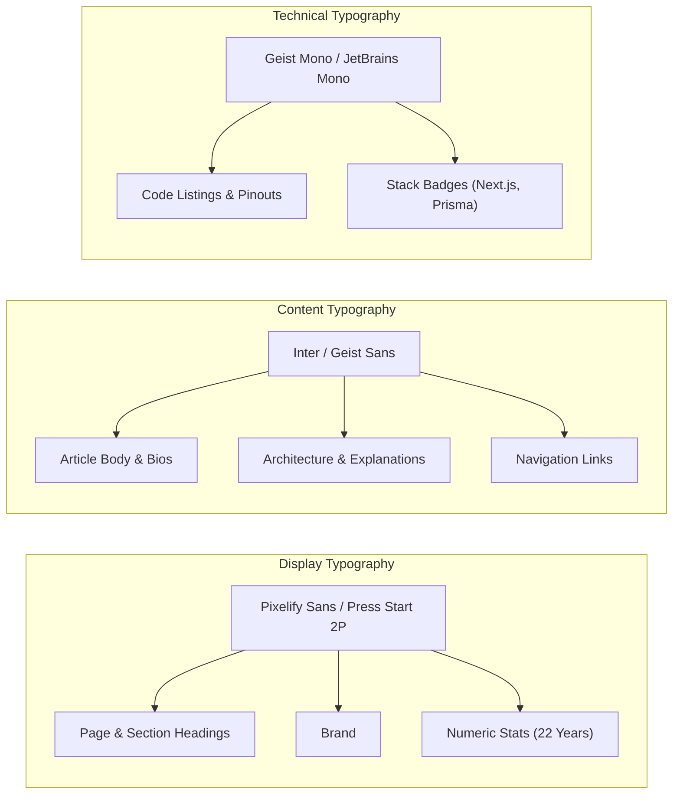

# Phase 3: Visual Design System & CSS Token Specifications
> **Document ID:** AGENT-PHASE-03  
> **Target Project:** Manish.dev — The Builder's World  
> **Status:** Approved Baseline  
> **Target Engine:** Antigravity / Gemini 3.8 Flash  

---

## 3.1 Color Tokens & Palette Architecture

All styling derives strictly from the authentic Minecraft palette extracted from the reference screenshot.

```
+-----------------------------------------------------------------------------------+
| #101E37         | #254B32        | #30251D      | #493421     | #1C1B19  | #252320 |
| Twilight Sky    | Forest Canopy  | Deep Oak     | Dark Wood   | Charcoal | Inner   |
+-----------------------------------------------------------------------------------+
| #36C653         | #8DE6A0        | #F5C66B      | #77736D     | #F4F0E8  | #C8C0B3 |
| Creeper Green   | Soft Emerald   | Lantern Gold | Stone Bevel | Warm Wht | Cream   |
+-----------------------------------------------------------------------------------+
```

### Complete CSS Variable System (`globals.css`)
```css
:root {
  /* Environmental Backgrounds */
  --color-sky-deep: #101e37;
  --color-sky-horizon: #1e3352;
  --color-forest-dark: #1b3824;
  --color-forest-accent: #254b32;

  /* UI Frame & Wooden Surfaces */
  --color-wood-border-dark: #30251d;    /* Outer dark oak bevel */
  --color-wood-frame: #493421;          /* Primary wooden border */
  --color-wood-highlight: #6b4d32;      /* Top-left lit bevel */
  --color-wood-shadow: #221811;         /* Bottom-right shadow bevel */

  /* Inset Content Surfaces */
  --color-panel-bg: #1c1b19;            /* Main dark panel surface */
  --color-card-bg: #252320;             /* Inset card surface */
  --color-card-border: #38342e;         /* Inset card border */
  --color-slot-bg: #141312;             /* Inventory slot interior */

  /* Interactive Accents */
  --color-emerald-primary: #36c653;     /* Minecraft green button */
  --color-emerald-hover: #42df64;       /* Green button hover */
  --color-emerald-shadow: #1e7a33;      /* Green button 3D bottom bevel */
  --color-emerald-soft: #8de6a0;        /* Active tabs & glowing borders */
  --color-lantern-gold: #f5c66b;        /* Gold arrows, stars & highlights */
  --color-stone-border: #77736d;        /* Stone / iron border accent */

  /* High-Contrast Typography */
  --color-text-title: #f4f0e8;          /* Warm white for headers */
  --color-text-body: #d2cbbf;           /* Highly legible body text */
  --color-text-muted: #8e8a82;          /* Timestamps & subtitles */
  --color-text-inverse: #141312;        /* Dark text on bright buttons */

  /* Dimensions & Spacing */
  --border-block-width: 3px;
  --radius-panel: 4px;
  --radius-card: 3px;
  --max-content-width: 1440px;
}
```

---

## 3.2 Typography System

To ensure professional engineering credibility, typography is bifurcated: **Display typography** for gaming immersion, and **High-Legibility typography** for content.



### Type Hierarchy
| Level | Font Family | Size (Desktop) | Weight | Line Height | Usage |
| :--- | :--- | :--- | :--- | :--- | :--- |
| **Hero Display** | Pixelify Sans | 56px / 3.5rem | 700 Bold | 1.1 | "Manish Kumar" with 3D drop-shadow |
| **Section Title** | Pixelify Sans | 22px / 1.375rem | 700 Bold | 1.2 | "Featured Projects", "About Me" |
| **Card Title** | Pixelify Sans | 16px / 1.0rem | 600 SemiBold | 1.25 | "Locus", "CohortX", "Smart Fan" |
| **Body Primary** | Inter / Geist | 15px / 0.9375rem| 400 Regular | 1.5 | About Me bio, article summaries |
| **Tag & Badge** | Geist Mono | 12px / 0.75rem | 500 Medium | 1.0 | `Next.js`, `ESP8266`, `12 min` |
| **Meta Timestamp**| Inter / Geist | 12px / 0.75rem | 400 Regular | 1.4 | "Oct 20, 2026", "2h ago" |

---

## 3.3 Authentic Minecraft Block Borders & Insets

Instead of generic rounded CSS borders, surfaces use **Minecraft-style beveled extrusion box-shadows**.

```css
/* Outer Wooden Container Panel */
.mc-panel-wood {
  background-color: var(--color-panel-bg);
  border: 4px solid var(--color-wood-frame);
  box-shadow: 
    inset 2px 2px 0px 0px var(--color-wood-highlight),
    inset -2px -2px 0px 0px var(--color-wood-shadow),
    0px 4px 12px rgba(0, 0, 0, 0.65);
  border-radius: var(--radius-panel);
}

/* Inset Content Card (Cards inside panels) */
.mc-card-inset {
  background-color: var(--color-card-bg);
  border: 2px solid var(--color-card-border);
  box-shadow: 
    inset 2px 2px 0px 0px rgba(0, 0, 0, 0.5),
    inset -1px -1px 0px 0px rgba(255, 255, 255, 0.08);
  border-radius: var(--radius-card);
}

/* Inventory Slot (Item grid in Tech Stack) */
.mc-inventory-slot {
  background-color: var(--color-slot-bg);
  border: 2px solid #302c28;
  box-shadow: 
    inset 2px 2px 0px 0px #0b0a09,
    inset -1px -1px 0px 0px #4d463f;
  width: 48px;
  height: 48px;
  display: flex;
  align-items: center;
  justify-content: center;
  position: relative;
  transition: transform 0.1s ease, border-color 0.1s ease;
}

.mc-inventory-slot:hover {
  border-color: var(--color-emerald-soft);
  transform: scale(1.08);
}
```

---

## 3.4 Button & Interactive Component Specifications

### 1. Primary Action: Creeper Green Button (`[creeper] View My Work ->`)
- **Background:** `#36C653`
- **Top/Left Bevel:** `#54e470`
- **Bottom/Right Bevel:** `#1e7a33`
- **Text Color:** `#141312` (Dark ink for AAA contrast)
- **Hover State:** Background lightens to `#42df64`, raises 1px.
- **Active / Pressed:** Downward displacement of 2px, inverted bevel shadows.

```css
.mc-btn-primary {
  background-color: var(--color-emerald-primary);
  color: var(--color-text-inverse);
  font-family: var(--font-pixel);
  font-size: 14px;
  font-weight: 700;
  padding: 10px 18px;
  display: inline-flex;
  align-items: center;
  gap: 8px;
  border: 2px solid #144f22;
  box-shadow: 
    inset 2px 2px 0px #5ef07b,
    inset -2px -2px 0px #1e7a33,
    0px 3px 0px #0e3517;
  cursor: pointer;
  transition: filter 0.12s ease;
}

.mc-btn-primary:hover {
  filter: brightness(1.08);
}

.mc-btn-primary:active {
  transform: translateY(2px);
  box-shadow: 
    inset 2px 2px 0px #1e7a33,
    inset -2px -2px 0px #5ef07b,
    0px 1px 0px #0e3517;
}
```

### 2. Secondary Action: Dark Spruce Button (`[book] Read My Blog`)
- **Background:** `#493421`
- **Top/Left Bevel:** `#6b4d32`
- **Bottom/Right Bevel:** `#221811`
- **Text Color:** `#F4F0E8`
- **Hover State:** Border accents to `--color-lantern-gold` (`#F5C66B`).

---

## 3.5 Hanging Wooden Signs Component (`HangingSigns.tsx`)

On the right side of the hero, 5 wooden signboards hang connected by iron chains:

```
    ||                     ||  (Iron Chains)
  +---------------------------+
  | [⛏️] Build Projects       |
  +---------------------------+
    ||                     ||
  +---------------------------+
  | [🪶] Write & Share        |
  +---------------------------+
    ||                     ||
  +---------------------------+
  | [📖] Learn & Document     |
  +---------------------------+
    ||                     ||
  +---------------------------+
  | [🧭] Open Source          |
  +---------------------------+
    ||                     ||
  +---------------------------+
  | [📦] Keep Exploring       |
  +---------------------------+
```

### Micro-Animation Behavior:
- Subtle ambient pendulum sway (`@keyframes gentle-sway { 0%, 100% { transform: rotate(0deg); } 50% { transform: rotate(0.4deg); } }`).
- Individual sign hover: Slides right 4px, background oak tint shifts, chain links tighten.
- Clicking any sign scrolls smoothly or routes directly to its target section.
