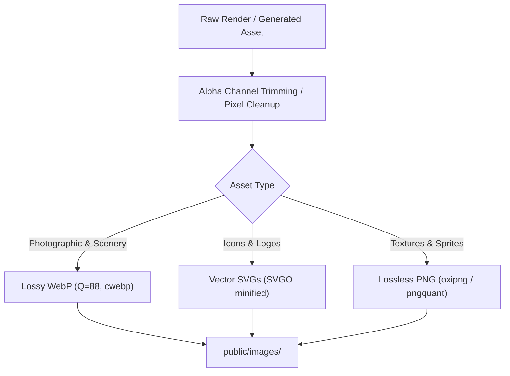

# Phase 4: Visual Asset Production & Prompt Engineering Matrix
> **Document ID:** AGENT-PHASE-04  
> **Target Project:** Manish.dev — The Builder's World  
> **Status:** Approved Baseline  
> **Target Engine:** Antigravity / Gemini 3.8 Flash  

---

## 4.1 Master Asset Inventory & Directory Tree

All visual and audio assets reside in strict static public directories. The coding agent must never refer to missing or placeholder URLs.

```
public/
├── images/
│   ├── hero/
│   │   ├── hero-bg-twilight.webp      [2560x1440 - Panoramic Minecraft twilight world]
│   │   ├── character-cliff.webp       [800x800 - Manish sitting on mossy cliff in black hoodie]
│   │   └── avatar-portrait.webp       [512x512 - Pixel art Manish avatar head]
│   ├── projects/
│   │   ├── locus-cover.webp           [1280x720 - Modern luxury Minecraft estate at sunset]
│   │   ├── cohortx-cover.webp         [1280x720 - Obsidian monolith with glowing digital portal]
│   │   ├── smart-fan-cover.webp       [1280x720 - Redstone IoT workshop with fan & sensors]
│   │   └── portfolio-3d-cover.webp    [1280x720 - Nether portal in enchanted forest clearing]
│   ├── blog/
│   │   ├── blog-locus-mvp.webp        [800x450 - Cabin workshop with blueprints]
│   │   ├── blog-prisma-neon.webp      [800x450 - Modern stone foundation build]
│   │   └── blog-iot-sensors.webp      [800x450 - Redstone comparator & dispenser lab]
│   ├── films/
│   │   ├── film-locus-demo.webp       [800x450 - Interior luxury villa walkthrough]
│   │   ├── film-cohortx-demo.webp     [800x450 - Village town square showcase]
│   │   └── film-smartfan-demo.webp    [800x450 - Piston engine automated fan demo]
│   └── textures/
│       ├── wood-oak-tile.png          [64x64 - Seamless dark oak plank texture]
│       ├── stone-bevel-tile.png       [32x32 - Chiseled stone border]
│       ├── chain-link.png             [16x32 - Pixel iron chain segment]
│       └── lantern-glow.webp          [256x256 - Warm radial light texture]
├── icons/
│   ├── nav/
│   │   ├── icon-home.svg              [24x24 - Pixel house / crafting table]
│   │   ├── icon-about.svg             [24x24 - Pixel player head]
│   │   ├── icon-projects.svg          [24x24 - Diamond pickaxe]
│   │   ├── icon-blog.svg              [24x24 - Book and quill]
│   │   ├── icon-tweets.svg            [24x24 - Light blue feather]
│   │   ├── icon-films.svg             [24x24 - Pixel film clapperboard]
│   │   ├── icon-stack.svg             [24x24 - Crafting table]
│   │   ├── icon-docs.svg              [24x24 - Enchanted tome with gold ribbon]
│   │   └── icon-emerald.svg           [24x24 - Glowing green emerald]
│   └── stack/
│       ├── nextjs.svg, react.svg, nodejs.svg, prisma.svg, postgresql.svg
│       ├── typescript.svg, tailwind.svg, docker.svg, esp8266.svg, cpp.svg
│       └── python.svg, git.svg, linux.svg, threejs.svg, mongodb.svg
└── audio/ (Optional toggle)
    ├── click-wood.mp3                 [Authentic wooden button click]
    └── pop-item.mp3                   [Minecraft item pickup pop]
```

---

## 4.2 Pixel-Art Generation Prompts (Gemini / Imagen 3)

For generating original visual assets that faithfully mirror the reference image without trademark or copyright violations:

### 1. Hero Panoramic Background (`hero-bg-twilight.webp`)
> **Prompt:**  
> `High-resolution 2D pixel art landscape inspired by block-building voxel worlds at twilight. In the background, a deep indigo and navy blue night sky scattered with soft glowing stars and a setting golden square sun on the far right horizon. Cascading mountain cliffs of blocky stone and grass, with a cozy multi-story wooden cabin perched on the hillside, warm orange lantern light glowing through square windows, a cascading waterfall flowing into a river below, distant floating sky islands with spruce trees, lush forest canopy with lanterns hanging from oak branches. Rich atmospheric perspective, cinematic lighting, clean pixel edges, vibrant and cozy aesthetic, completely free of any text, logos, character models, or UI frames. Aspect ratio 16:9.`

### 2. Sitting Character (`character-cliff.webp`)
> **Prompt:**  
> `2D pixel art game sprite of a young male character inspired by voxel aesthetics, sitting comfortably at the edge of a grassy block cliff with legs dangling over the edge, viewed from the three-quarters back/side perspective. He has brown messy hair and is wearing a dark black hoodie with relaxed casual pants. Next to him on the grass block rests an illuminated hanging iron lantern emitting a cozy warm golden glow. Transparent background, sharp clean pixel art contours, no anti-aliasing artifacts, no text. Aspect ratio 1:1.`

### 3. Project Cover: Locus Real Estate (`locus-cover.webp`)
> **Prompt:**  
> `2D pixel art illustration of a stunning modern luxury architectural villa built from smooth quartz, oak planks, and dark glass panes in a lush green valley at sunset. Golden hour lighting casting warm reflections on glass windows, landscaped block garden with lanterns and water feature. Premium, serene, polished voxel architecture. Clean 16:9 aspect ratio, no UI text, no watermark.`

### 4. Project Cover: CohortX Social Monolith (`cohortx-cover.webp`)
> **Prompt:**  
> `2D pixel art illustration of a monumental obsidian and dark prismarine structure with a glowing cyan technological portal in the center, set in a twilight grassy clearing. Wooden directional road signposts pointing in multiple directions. Vibrant blue digital illumination reflecting off dark polished blocks. Clean 16:9 composition, no text.`

### 5. Project Cover: Smart Fan IoT Workshop (`smart-fan-cover.webp`)
> **Prompt:**  
> `2D pixel art cozy inventor's workshop cabin in a spruce forest. Outside on a wooden porch sits an intricate redstone and iron contraption with spinning wooden blades (fan) connected to copper wiring, glowing redstone repeaters, and sensor crystals. Warm welcoming lantern glow, atmospheric evening mist. Clean 16:9 composition, no text.`

### 6. Project Cover: 3D Portfolio Net Portal (`portfolio-3d-cover.webp`)
> **Prompt:**  
> `2D pixel art mystical obsidian portal glowing with vibrant swirling purple and violet vortex energy, framed by ancient mossy cobblestone and towering dark forest trees. Fireflies and magical purple particles floating in the night air. Clean 16:9 composition, no text.`

---

## 4.3 Asset Optimization & Responsive Quality Standards



- **Target File Sizes:**
  - Background panoramic: `< 220 KB` (WebP)
  - Project covers: `< 75 KB` each (WebP)
  - Icons: `< 2.5 KB` each (SVG)
- **Sharp Pixel Art Rendering:**  
  All pixel textures and icons must enforce CSS image rendering:
  ```css
  .pixelated {
    image-rendering: -moz-crisp-edges;
    image-rendering: -webkit-crisp-edges;
    image-rendering: pixelated;
    image-rendering: crisp-edges;
  }
  ```
