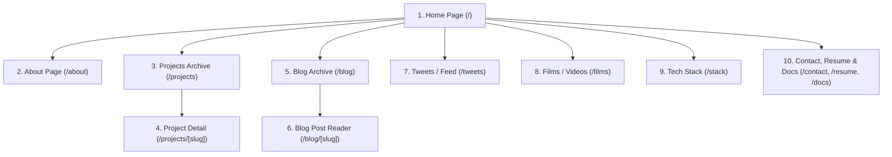

# Phase 5: Complete 10-Page Master Design Specifications
> **Document ID:** AGENT-PHASE-05  
> **Target Project:** Manish.dev — The Builder's World  
> **Visual Reference:** 10-Page Master Visual Reference Sheet  
> **Status:** Approved Baseline (All 10 Pages Defined)  
> **Target Engine:** Antigravity / Gemini 3.8 Flash  

---

## 5.0 Visual Master Layout & 10-Page Map



---

## 5.1 Page 1: Home Page ("Spawn")
**Route:** `/`

```
+=======================================================================================================+
| [NAVBAR] <Manish.dev>   [Home] [About] [Projects] [Blog] [Tweets] [Films] [Stack] [Docs]  [Let's Connect]
+=======================================================================================================+
| [HERO REGION: Twilight Pixel Forest Panorama, Waterfall, Cabin in Trees, Square Sun]                  |
|                                                                                                       |
|  Hey, I'm                                                       [HANGING WOODEN SIGNS (Chains)]       |
|  Manish Kumar                                                    - [⛏️] Build Projects               |
|  B.Tech CSE (IoT) @ NIET                                         - [🪶] Write & Share                |
|  Building real projects, learning in public, and cool stuff.     - [📖] Learn & Document             |
|                                                                  - [🧭] Open Source                  |
|  [🟩 View My Work ->]   [🪵 Read My Blog]                        - [📦] Keep Exploring               |
|                                                                                                       |
|  [Sitting Character on Cliff + Glowing Lantern]                                                       |
+=======================================================================================================+
| [BOTTOM QUICK-STATS BAR]                                                                              |
| +--------------------+ +--------------------+ +--------------------+ +------------------------------+ |
| | [📦] 22 Years      | | [🏛️] CSE (IoT) NIET| | [📍] India Home    | | [🛡️] Builder Always          | |
| +--------------------+ +--------------------+ +--------------------+ +------------------------------+ |
+=======================================================================================================+
```

### Components & Layout:
1. **Top Navbar (`Navbar.tsx`):**
   - Brand: `<Manish.dev>` with pixel brackets.
   - 8 Tabs with 16x16 pixel icons: Home (active green underline), About, Projects, Blog, Tweets, Films, Stack, Docs.
   - Right: Green CTA `[💎 Let's Connect ->]`.
2. **Hero Section (`HeroSection.tsx`):**
   - Background: 16:9 pixel-art twilight forest panorama, waterfall, cozy cliff house, square sunset sun, starlit sky.
   - Left Foreground: Manish sitting on cliff edge with legs dangling, brown hair, black hoodie, glowing lantern on stone.
   - Text Content:
     - "Hey, I'm" (`Pixelify Sans`, 20px, `#F4F0E8`)
     - "Manish Kumar" (`Pixelify Sans`, 56px, bold, `#36C653` with 3D drop-shadow `#1e7a33`)
     - "B.Tech CSE (IoT) @ NIET" (Inter, 16px, `#F5C66B`)
     - "Building real projects, learning in public, and creating cool stuff." (Inter, 15px, `#C8C0B3`)
     - Actions: `[+] View My Work` (Emerald green `.mc-btn-primary`), `[📖] Read My Blog` (Dark oak `.mc-btn-secondary`).
3. **Hanging Wooden Signs (`HangingSigns.tsx`):**
   - Suspended by iron chain graphics on the right side of the hero:
     - `[⛏️] Build Projects` -> `/projects`
     - `[🪶] Write & Share` -> `/blog`
     - `[📖] Learn & Document` -> `/docs`
     - `[🧭] Open Source` -> GitHub
     - `[📦] Keep Exploring` -> `/stack`
4. **Bottom Stats Shelf (`HomeStatsBar.tsx`):**
   - 4 equal-width inset wooden cards:
     1. `[📦] 22 Years`
     2. `[🏛️] CSE (IoT) NIET`
     3. `[📍] India Home`
     4. `[🛡️] Builder Always`

---

## 5.2 Page 2: About Page ("Player Profile")
**Route:** `/about`

```
+=======================================================================================================+
| [NAVBAR]                                                                                              |
+=======================================================================================================+
| [HEADER: Forest Canopy Backdrop]                                                                      |
| About Me                                                                                              |
| A curious builder from India.                                                                         |
|                                                                                                       |
| "I'm Manish, a CSE (IoT) student who loves building projects, learning new tech and sharing the        |
|  journey. I enjoy working on Web, IoT, AI and creative tech."                                         |
+-------------------------------------------------------------------------------------------------------+
| [INTERACTIVE TABBED CONTAINER (.mc-panel-wood)]                                                        |
| [  [Journey] (Active)  |  [Skills]  |  [Education]  |  [Interests]  ]                                 |
|                                                                                                       |
|  +--------+                                                                                           |
|  |  2022  |  Started B.Tech                                                                           |
|  | (Green)|  Joined NIET, CSE (IoT)                                                                   |
|  +--------+                                                                                           |
|      |                                                                                                |
|  +--------+                                                                                           |
|  |  2023  |  Explored Web Dev                                                                         |
|  | (Green)|  HTML, CSS, JavaScript, React                                                             |
|  +--------+                                                                                           |
|      |                                                                                                |
|  +--------+                                                                                           |
|  |  2024  |  IoT & Embedded                                                                           |
|  | (Green)|  Sensors, Microcontrollers                                                                |
|  +--------+                                                                                           |
|      |                                                                                                |
|  +--------+                                                                                           |
|  |  2025  |  AI & Generative AI                                                                       |
|  | (Green)|  Building small AI projects                                                               |
|  +--------+                                                                                           |
|      |                                                                                                |
|  +--------+                                                                                           |
|  |  Now   |  Building in Public                                                                       |
|  | (Green)|  Sharing projects, blogs and learning                                                     |
|  +--------+                                                                                           |
+=======================================================================================================+
```

### Components & Tabs:
- **Header:** "About Me" (`Pixelify Sans`, 36px) + Subtitle: "A curious builder from India."
- **Bio Box:** High-legibility developer philosophy description.
- **Tab Bar:** 4 buttons: `Journey`, `Skills`, `Education`, `Interests`.
- **Journey Tab:** Vertical timeline with glowing green year pill badges (`2022`, `2023`, `2024`, `2025`, `Now`), branch connector lines, bold title, and description.
- **Skills Tab:** Categorized breakdown of programming languages, hardware toolkits, and frameworks.
- **Education Tab:** NIET B.Tech CSE (IoT) coursework, GPA/Milestones, and academic projects.
- **Interests Tab:** Creative tech, open-source building, hardware hacking, voxel art.

---

## 5.3 Page 3: Projects Page ("The Build Room")
**Route:** `/projects`

```
+=======================================================================================================+
| [NAVBAR]                                                                                              |
+=======================================================================================================+
| Projects                                                                                              |
| Things I've built and shipped.                                                                        |
|                                                                                                       |
| [Filter Bar]:                                                                                         |
| [🟩 All]  [Web]  [IoT]  [AI]  [3D]  [Other]             [ 🔍 Search projects...                     ] |
+-------------------------------------------------------------------------------------------------------+
| [PROJECTS GRID: 2 Columns on Desktop, 1 Column on Mobile]                                             |
| +-----------------------------------------+ +-----------------------------------------+               |
| | [Cover: Modern Villa at Sunset]         | | [Cover: Obsidian Monolith + Portal]     |               |
| | Locus                                   | | CohortX                                 |               |
| | AI Real Estate Platform                 | | Social Platform for Projects            |               |
| | [Next.js]  [Prisma]  [AI]               | | [React]  [Node.js]  [PostgreSQL]        |               |
| +-----------------------------------------+ +-----------------------------------------+               |
| +-----------------------------------------+ +-----------------------------------------+               |
| | [Cover: Cabin Workshop + Fan]           | | [Cover: Nether Portal Clearing]         |               |
| | Smart Fan (IoT)                         | | 3D Portfolio (WIP)                      |               |
| | Automated Fan System                    | | Interactive Portfolio                   |               |
| | [ESP8266]  [DHT11]  [IoT]               | | [Three.js]  [Next.js]  [3D]             |               |
| +-----------------------------------------+ +-----------------------------------------+               |
| +-----------------------------------------+ +-----------------------------------------+               |
| | [Cover: Pixel Airship / Automation]     | | [Cover: Golden Citadel / Bot Platform]  |               |
| | WebPilot                                | | Hermes Agent                            |               |
| | AI Web Automation                       | | AI Agent Platform                       |               |
| | [Python]  [Next.js]  [AI]               | | [Next.js]  [AI]                         |               |
| +-----------------------------------------+ +-----------------------------------------+               |
+=======================================================================================================+
```

### Components:
- **Category Filter Pills:** `All`, `Web`, `IoT`, `AI`, `3D`, `Other` (Active pill has emerald green background `#36C653`, black text).
- **Search Input:** Real-time client-side fuzzy filter matching title, description, or tech tags.
- **Project Cards (6 Total):**
  1. **Locus:** AI Real Estate Platform (`Next.js`, `Prisma`, `AI`)
  2. **CohortX:** Social Platform for Projects (`React`, `Node.js`, `PostgreSQL`)
  3. **Smart Fan (IoT):** Automated Fan System (`ESP8266`, `DHT11`, `IoT`)
  4. **3D Portfolio (WIP):** Interactive Portfolio (`Three.js`, `Next.js`, `3D`)
  5. **WebPilot:** AI Web Automation (`Python`, `Next.js`, `AI`)
  6. **Hermes Agent:** AI Agent Platform (`Next.js`, `AI`)

---

## 5.4 Page 4: Project Detail Page ("Deep Case Study")
**Route:** `/projects/[slug]` (e.g. `/projects/locus`)

```
+=======================================================================================================+
| [NAVBAR]                                                                                              |
+=======================================================================================================+
| [HERO BANNER: Full-width 16:9 Showcase of Locus Modern Villa]                                         |
|                                                                                                       |
| Locus                                                                                                 |
| AI Powered Real Estate Platform                                                                       |
| "A modern real estate platform with an AI voice agent for each property, virtual tours and            |
|  interactive listings."                                                                               |
|                                                                                                       |
| [🟩 Live Demo ->]     [🪵 GitHub]                                                                     |
|                                                                                                       |
| [Next.js 14]  [Prisma]  [PostgreSQL]  [AI]  [Tailwind]                                                |
+-------------------------------------------------------------------------------------------------------+
| [CASE STUDY TABS: Overview (Active) | Features | Tech Stack | Screenshots | Learnings]                |
|                                                                                                       |
| Overview                                                                                              |
| Locus is a real estate platform that allows buyers to explore properties with AI powered voice         |
| agents and immersive virtual tours.                                                                   |
|                                                                                                       |
| [SCREENSHOTS CAROUSEL]                                                                                |
| +---------------------------------------------------------------------------------------------------+ |
| | [Screenshot Preview: Villa Poolside at Twilight]                                                  | |
| +---------------------------------------------------------------------------------------------------+ |
|                                              ( •  •  • )                                              |
+=======================================================================================================+
```

### Key Elements:
- **Action CTAs:** Green `Live Demo` with arrow icon + Oak `GitHub` repository link.
- **Tech Stack Pills:** Explicit framework versions (`Next.js 14`, `Prisma`, `PostgreSQL`, `AI`, `Tailwind`).
- **Interactive Tabs:**
  1. `Overview`: Problem statement, target user personas, core innovation.
  2. `Features`: AI voice tour agent, interactive 3D floor plan viewer, dynamic pricing calculator.
  3. `Tech Stack`: Client, server, and Neon PostgreSQL serverless pooling architecture.
  4. `Screenshots`: High-res screenshot carousel with navigation dots `( • • • )`.
  5. `Learnings`: Production bottlenecks, OpenAI audio latency optimizations, Prisma migrations.

---

## 5.5 Page 5: Blog Archive ("The Library")
**Route:** `/blog`

```
+=======================================================================================================+
| [NAVBAR]                                                                                              |
+=======================================================================================================+
| Blog                                                                                                  |
| Notes, tutorials and things I learn.                                                                  |
|                                                                                                       |
| [Filter Bar]:                                                                                         |
| [🟩 All]  [Web Dev]  [AI]  [IoT]  [DSA]  [Other]         [ 🔍 Search articles...                    ] |
+-------------------------------------------------------------------------------------------------------+
| [ARTICLES LIST: Wooden Inset Cards with Thumbnails]                                                   |
|                                                                                                       |
| +----+  How I Built Locus From Idea to MVP                                                            |
| |IMG |  Complete journey from idea to a working real estate platform.                                 |
| +----+  Oct 20, 2026 • 8 min read                                                                     |
|                                                                                                       |
| +----+  Setting Up Next.js + Prisma with Neon Postgres                                                |
| |IMG |  A step by step guide for modern full stack.                                                   |
| +----+  Oct 12, 2026 • 5 min read                                                                     |
|                                                                                                       |
| +----+  My IoT Learning Journey                                                                       |
| |IMG |  From sensors to smart systems.                                                                |
| +----+  Oct 05, 2026 • 6 min read                                                                     |
|                                                                                                       |
| +----+  Exploring Generative AI Tools                                                                 |
| |IMG |  How I use AI tools in my workflow.                                                            |
| +----+  Sep 28, 2026 • 4 min read                                                                     |
|                                                                                                       |
| +----+  Three.js for 3D Portfolio                                                                     |
| |IMG |  Creating interactive 3D experiences.                                                          |
| +----+  Sep 20, 2026 • 6 min read                                                                     |
+=======================================================================================================+
```

### Components:
- **Filters:** `All`, `Web Dev`, `AI`, `IoT`, `DSA`, `Other`.
- **Search Bar:** Real-time filter across article titles and summaries.
- **Article Card Structure:** 80x80 pixel thumbnail, title (hover: `#8DE6A0`), summary, metadata (`Date • Read Time`).

---

## 5.6 Page 6: Blog Post Reader ("The Enchanted Tome")
**Route:** `/blog/[slug]` (e.g. `/blog/how-i-built-locus`)

```
+=======================================================================================================+
| [NAVBAR]                                                                                              |
+=======================================================================================================+
| [HERO HEADER: Forest Canopy Backdrop]                                                                 |
| How I Built Locus From Idea to MVP                                                                    |
| 📅 Oct 20, 2026 • 8 min read • Web Dev                                                                |
+-------------------------------------------------------------------------------------------------------+
| [TWO-COLUMN READER LAYOUT: 1/4 Table of Contents + 3/4 Article Content]                               |
|                                                                                                       |
| +-----------------------------+  +------------------------------------------------------------------+ |
| | Table of Contents           |  | 1. The Idea                                                      | |
| |                             |  |                                                                  | |
| | 1. The Idea                 |  | I wanted to create a platform where each property has an AI      | |
| | 2. Planning                 |  | agent that can answer questions and give a virtual tour.         | |
| | 3. Tech Stack               |  |                                                                  | |
| | 4. Development              |  | // Example code                                                  | |
| | 5. Challenges               |  | const property = await prisma.property.findMany({                | |
| | 6. Learnings                |  |   where: {                                                       | |
| | 7. Next Steps               |  |     location: "Greater Noida"                                        | |
| |                             |  |   }                                                              | |
| |                             |  | });                                                              | |
| +-----------------------------+  +------------------------------------------------------------------+ |
+=======================================================================================================+
```

### Reader Specifications:
- **Sticky Sidebar (Left):** Minecraft wooden panel holding active Table of Contents with jump links.
- **Main Article Column (Right):** Clear, readable typography (Inter, 16px, line-height: 1.7).
- **Code Block:** Dark obsidian surface (`#121110`), syntax highlighted keywords, copy button with checkmark feedback.

---

## 5.7 Page 7: Tweets / Feed ("Town Square Notice Board")
**Route:** `/tweets`

```
+=======================================================================================================+
| [NAVBAR]                                                                                              |
+=======================================================================================================+
| Tweets                                                                                                |
| My thoughts, updates and quick notes.                                                                 |
|                                                                                                       |
| [Filter Bar]: [🟩 All]  [Updates]  [Learning]  [Projects]                                             |
+-------------------------------------------------------------------------------------------------------+
| [TWEET STREAM: Notice Board Inset Cards]                                                              |
|                                                                                                       |
| +---------------------------------------------------------------------------------------------------+ |
| | [🪶 Pixel Bird]  Pushed a new feature to Locus 🚀                                                  | |
| |                  The AI property tour is now working!                                             | |
| |                  2h ago                                                         ❤️ 12   💬 3      | |
| +---------------------------------------------------------------------------------------------------+ |
| +---------------------------------------------------------------------------------------------------+ |
| | [🪶 Pixel Bird]  Exploring Three.js for my 3D portfolio. This is going to be fun 🎮                 | |
| |                  1d ago                                                         ❤️ 24   💬 5      | |
| +---------------------------------------------------------------------------------------------------+ |
| +---------------------------------------------------------------------------------------------------+ |
| | [🪶 Pixel Bird]  Sometimes you just have to keep building. Little progress still counts.           | |
| |                  3d ago                                                         ❤️ 18   💬 2      | |
| +---------------------------------------------------------------------------------------------------+ |
| +---------------------------------------------------------------------------------------------------+ |
| | [🪶 Pixel Bird]  Working on IoT project today. Sensors + automation is so interesting!            | |
| |                  4d ago                                                         ❤️ 20   💬 4      | |
| +---------------------------------------------------------------------------------------------------+ |
+=======================================================================================================+
```

### Feed Specifications:
- **Filters:** `All`, `Updates`, `Learning`, `Projects`.
- **Card Elements:** Pixel Twitter bird icon, post text, relative timestamp (`2h ago`), engagement counts (`❤️ Likes`, `💬 Comments`).

---

## 5.8 Page 8: Films / Videos ("The Cinema Room")
**Route:** `/films`

```
+=======================================================================================================+
| [NAVBAR]                                                                                              |
+=======================================================================================================+
| Films                                                                                                 |
| Project demos, walkthroughs and tutorials.                                                            |
|                                                                                                       |
| [Filter Bar]: [🟩 All]  [Project Demos]  [Tutorials]  [Vlogs]                                         |
+-------------------------------------------------------------------------------------------------------+
| [FEATURED LARGE VIDEO HERO CARD]                                                                      |
| +---------------------------------------------------------------------------------------------------+ |
| | [LARGE VIDEO PREVIEW THUMBNAIL]                                                                   | |
| |                                          [ ▶ PLAY ]                                               | |
| |                                                                                                   | |
| | Locus — Full Demo                                                                                 | |
| | AI Powered Real Estate Platform                                                                   | |
| | 12 min                                                                                            | |
| +---------------------------------------------------------------------------------------------------+ |
|                                                                                                       |
| [SECONDARY VIDEO GRID (2 Columns)]                                                                    |
| +-----------------------------------------+ +-----------------------------------------+               |
| | [Thumbnail + ▶]                         | | [Thumbnail + ▶]                         |               |
| | CohortX — Project Walkthrough           | | Smart Fan — IoT Project                 |               |
| | 15 min                                  | | 8 min                                   |               |
| +-----------------------------------------+ +-----------------------------------------+               |
+=======================================================================================================+
```

### Components:
- Left decorative illustration: Pixel camera tripod beside the video gallery.
- Featured large video on top with prominent centered play button.
- Secondary video cards with duration badge.
- Clicking any video opens the `VideoModal` player with dimming backdrop.

---

## 5.9 Page 9: Tech Stack ("The Crafting Inventory")
**Route:** `/stack`

```
+=======================================================================================================+
| [NAVBAR]                                                                                              |
+=======================================================================================================+
| Tech Stack                                                                                            |
| Technologies I use and explore.                                                                       |
|                                                                                                       |
| +---------------------------------------------------------------------------------------------------+ |
| | Frontend                                                                                          | |
| |   [Next.js (NX)]      [React]          [TypeScript (TS)]    [Tailwind CSS]                        | |
| +---------------------------------------------------------------------------------------------------+ |
| | Backend                                                                                           | |
| |   [Node.js (hex)]     [Express.js (ex)][Prisma]             [PostgreSQL]                          | |
| +---------------------------------------------------------------------------------------------------+ |
| | Tools & Others                                                                                    | |
| |   [Git]               [Docker]         [Linux (Tux)]        [VS Code]                             | |
| +---------------------------------------------------------------------------------------------------+ |
+=======================================================================================================+
```

### Stack Shelves:
- Organized into 3 categorized wooden inset shelves:
  1. **Frontend:** `Next.js`, `React`, `TypeScript`, `Tailwind CSS`
  2. **Backend:** `Node.js`, `Express.js`, `Prisma`, `PostgreSQL`
  3. **Tools & Others:** `Git`, `Docker`, `Linux`, `VS Code`
- Interactive Hover: Slot zooms to `1.08x`, borders turn emerald green, and displays authentic Minecraft purple lore tooltip with experience details.

---

## 5.10 Page 10: Docs, Resume & Contact ("The Spawn Outpost")
**Routes:** `/contact`, `/resume`, `/docs`

```
+=======================================================================================================+
| [NAVBAR]                                                                                              |
+=======================================================================================================+
| Get In Touch                                                                                          |
| Let's connect and build something awesome together.                                                   |
|                                                                                                       |
| [SOCIAL CHANNELS ROW]:                                                                                |
| [ 🐱 GitHub ]       [ 💼 LinkedIn ]       [ 🐦 Twitter ]       [ ✉️ Email ]                           |
|                                                                                                       |
| [3 LARGE INTERACTIVE PORTAL TILES (.mc-panel-wood)]:                                                  |
| +------------------------+  +------------------------+  +------------------------+                    |
| | [📖] Docs              |  | [📄] Resume            |  | [✉️] Contact           |                    |
| | Notes & Resources      |  | Download PDF           |  | Send a Message         |                    |
| +------------------------+  +------------------------+  +------------------------+                    |
+=======================================================================================================+
```

### Portal Tile Actions:
1. **Docs Tile (`/docs`):** Navigates to technical setup guides, Prisma tips, and IoT hardware schematics.
2. **Resume Tile (`/resume`):** Displays clean developer CV with one-click verified PDF download button.
3. **Contact Tile (`/contact`):** Opens direct courier messaging form / mailto dispatcher (`manish@...`).
