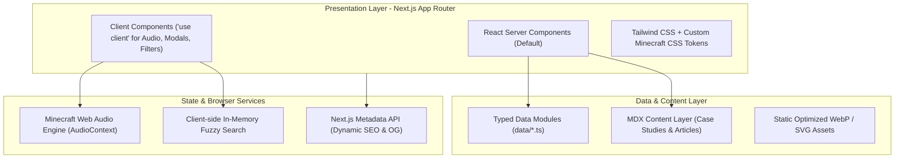
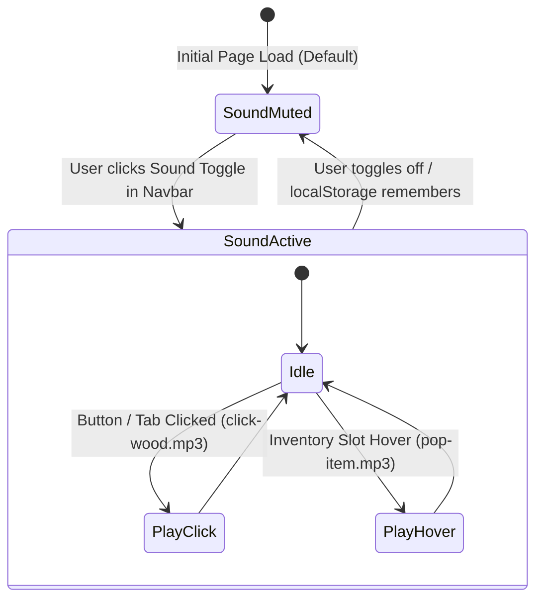

# Phase 6: Technical Architecture, Data Schemas & State
> **Document ID:** AGENT-PHASE-06  
> **Target Project:** Manish.dev — The Builder's World  
> **Status:** Approved Baseline  
> **Target Engine:** Antigravity / Gemini 3.8 Flash  

---

## 6.1 Technology Stack Architecture



| Layer | Selected Technology | Technical Rationale |
| :--- | :--- | :--- |
| **Framework** | Next.js 14+ (App Router) | Static site generation (SSG) for instant page loads, SSR for SEO, optimal image optimization. |
| **Language** | TypeScript (Strict mode) | Complete type safety across project metadata, blog posts, hardware specs, and tooltips. |
| **Styling** | Tailwind CSS + `globals.css` | High-speed utility development paired with pixel-perfect Minecraft bevel classes. |
| **Content Engine**| TypeScript data modules + MDX | Zero-database latency, fully version-controlled in Git, instant rebuilds, zero operational cost. |
| **Audio** | HTML5 Audio / Web Audio API | Lightweight (1KB) synthetic click effects with user opt-out persistence in `localStorage`. |
| **Icons** | Custom Pixel SVGs + Lucide | Authentic 16x16 / 24x24 Minecraft icons paired with crisp functional utility icons. |

---

## 6.2 Master Data Schemas (TypeScript Interfaces)

The data models in `src/data/` or `data/` enforce rigid structure for all portfolio artifacts:

```typescript
// 1. Projects Entity
export interface Project {
  id: string;
  slug: string;
  title: string;
  tagline: string;
  category: 'web' | 'iot' | 'ai' | 'fullstack';
  featured: boolean;
  coverImage: string;
  tags: string[];
  githubUrl?: string;
  liveUrl?: string;
  duration?: string;
  architectureSummary: string;
  caseStudy: {
    problem: string;
    solution: string;
    architectureDiagram: string;
    keyChallenges: string[];
    hardwarePinout?: string[]; // Specifically for IoT builds
    lessonsLearned: string[];
  };
}

// 2. Blog Post Entity
export interface BlogPost {
  slug: string;
  title: string;
  summary: string;
  publishedAt: string;
  readingTime: string;
  thumbnail: string;
  tags: string[];
  featured: boolean;
  relatedProjectSlug?: string;
  contentMdx?: string;
}

// 3. Tweet / Micro-Thought Entity
export interface Tweet {
  id: string;
  content: string;
  timestamp: string;
  relativeTime: string; // e.g. "2h ago", "1d ago"
  likesCount?: number;
  relatedProjectSlug?: string;
  externalLink?: string;
}

// 4. Film / Video Entity
export interface Film {
  slug: string;
  title: string;
  subtitle: string;
  duration: string; // e.g. "12 min"
  thumbnail: string;
  videoUrl: string; // Loom / YouTube / MP4
  relatedProjectSlug: string;
  description: string;
}

// 5. Tech Stack Inventory Item
export interface StackItem {
  id: string;
  name: string;
  category: 'frontend' | 'backend' | 'database' | 'iot' | 'devops' | 'tools';
  iconSvg: string;
  experienceYears: number;
  proficiencyLevel: 'Expert' | 'Advanced' | 'Proficient';
  projectsUsedIn: string[]; // Project IDs
  documentationRef?: string;
}
```

---

## 6.3 State Management & Client Services



### 1. Sound Engine (`SoundManager.ts`)
- Manages pre-buffered Minecraft UI sound clips.
- Volume normalized to -12dB so audio is crisp and non-intrusive.
- Automatically disabled if visitor has `prefers-reduced-motion` or audio toggle is OFF.

### 2. Modal & Filter State
- Managed via lightweight React `useState` / URL query parameters:
  - Video Modal Player (`?video=locus-demo`)
  - Inventory Item Inspector (`?item=nextjs`)
  - Category Filter (`/projects?category=iot`)

---

## 6.4 Directory & Component Scaffolding

```
minecraft-portfolio/
├── app/
│   ├── layout.tsx              # Root HTML, fonts, global pixel frames
│   ├── page.tsx                # Homepage dashboard (Spawn)
│   ├── about/page.tsx          # Extended Player Profile
│   ├── projects/
│   │   ├── page.tsx            # Projects gallery & category filter
│   │   └── [slug]/page.tsx     # Deep Case Study
│   ├── blog/
│   │   ├── page.tsx            # The Library article archive
│   │   └── [slug]/page.tsx     # Article reader
│   ├── tweets/page.tsx         # Town Square micro-feed
│   ├── films/page.tsx          # Video cinema showcase
│   ├── stack/page.tsx          # Inventory Room & crafting bench
│   ├── docs/page.tsx           # Technical knowledge base
│   ├── resume/page.tsx         # Verified developer resume
│   └── contact/page.tsx        # Courier pigeon dispatch
├── components/
│   ├── ui/
│   │   ├── Navbar.tsx          # Oak framed top bar
│   │   ├── Footer.tsx          # Wooden baseboard with links
│   │   ├── McButton.tsx        # Authentic beveled buttons
│   │   ├── McPanel.tsx         # Container panels with wood bevels
│   │   └── SoundToggle.tsx     # Audio button with state icon
│   ├── home/
│   │   ├── HeroSection.tsx     # Twilight panorama, character, CTA
│   │   ├── HangingSigns.tsx    # Wooden signs with chain physics
│   │   ├── FeaturedProjects.tsx# 4-card project row
│   │   ├── AboutMePanel.tsx    # Sidebar with avatar & stats
│   │   ├── LatestBlogPanel.tsx # 3-row blog feed
│   │   ├── LatestTweetsPanel.tsx# 3-row tweet feed
│   │   ├── FilmsPanel.tsx      # 3 video cards with play overlay
│   │   └── TechStackPanel.tsx  # 5x3 inventory slot matrix
│   └── modals/
│       ├── VideoModal.tsx      # Pixel theater player overlay
│       └── ItemInspector.tsx   # Minecraft item tooltip/dialog
├── data/
│   ├── projects.ts
│   ├── blog.ts
│   ├── tweets.ts
│   ├── films.ts
│   └── stack.ts
└── styles/
    └── globals.css             # Minecraft CSS tokens and bevels
```
