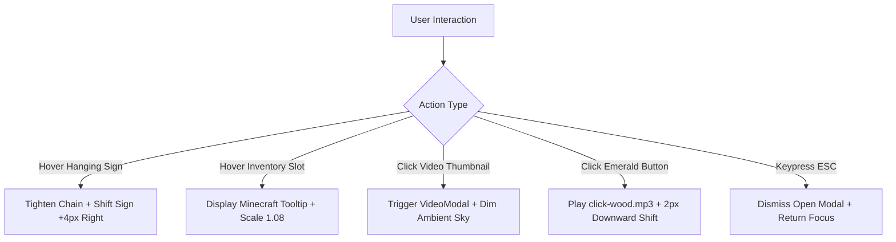

# Phase 7: Interactions, Micro-Animations & Audio Engine
> **Document ID:** AGENT-PHASE-07  
> **Target Project:** Manish.dev — The Builder's World  
> **Status:** Approved Baseline  
> **Target Engine:** Antigravity / Gemini 3.8 Flash  

---

## 7.1 Interaction Mechanics Map



---

## 7.2 Hanging Wooden Signs Sway Physics

The 5 wooden signs on the hero right panel mimic physical signboards suspended by iron chains.

```css
/* Origin anchored at the chain attachment */
.mc-hanging-sign-container {
  transform-origin: top center;
  animation: ambient-sway 6s ease-in-out infinite;
}

@keyframes ambient-sway {
  0%, 100% {
    transform: rotate(0deg);
  }
  33% {
    transform: rotate(0.4deg);
  }
  66% {
    transform: rotate(-0.35deg);
  }
}

/* Individual Sign Hover */
.mc-sign-item {
  transition: transform 0.18s cubic-bezier(0.2, 0.8, 0.2, 1), background-color 0.18s ease;
}

.mc-sign-item:hover {
  transform: translateX(6px);
  background-color: #5c4228;
  border-color: var(--color-lantern-gold);
}
```

---

## 7.3 Minecraft Inventory Tooltip System

Hovering over any item in the **Tech Stack** inventory displays an authentic Minecraft tooltip with purple lore styling:

```
+----------------------------------------------------+
|  Next.js                                           | <- Golden Yellow (#F5C66B)
|  Core Fullstack Framework                          | <- White (#FFFFFF)
|                                                    |
|  • Proficiency: Expert                             | <- Cyan / Light Blue (#55FFFF)
|  • Experience: 2+ Years                            | <- Light Gray (#AAAAAA)
|  • Shipped Builds: Locus, 3D Portfolio             | <- Dark Purple / Magenta (#FF55FF)
+----------------------------------------------------+
```

### CSS Implementation:
```css
.mc-tooltip {
  background-color: #100010;
  border: 2px solid #28004b;
  box-shadow: 
    inset 1px 1px 0px #4d0080,
    0px 4px 14px rgba(0, 0, 0, 0.8);
  padding: 8px 12px;
  border-radius: 2px;
  pointer-events: none;
  z-index: 100;
}
```

---

## 7.4 Web Audio Engine (`SoundService.ts`)

A lightweight, zero-dependency audio synthesizer that plays authentic tactile click sounds when visitors interact with buttons:

```typescript
class SoundService {
  private ctx: AudioContext | null = null;
  private enabled: boolean = false;

  constructor() {
    if (typeof window !== 'undefined') {
      this.enabled = localStorage.getItem('mc_sound_enabled') === 'true';
    }
  }

  public toggleSound(): boolean {
    this.enabled = !this.enabled;
    localStorage.setItem('mc_sound_enabled', String(this.enabled));
    if (this.enabled) this.playWoodClick();
    return this.enabled;
  }

  public isEnabled(): boolean {
    return this.enabled;
  }

  public playWoodClick() {
    if (!this.enabled) return;
    try {
      if (!this.ctx) this.ctx = new (window.AudioContext || (window as any).webkitAudioContext)();
      const osc = this.ctx.createOscillator();
      const gain = this.ctx.createGain();
      
      osc.type = 'triangle';
      osc.frequency.setValueAtTime(140, this.ctx.currentTime);
      osc.frequency.exponentialRampToValueAtTime(40, this.ctx.currentTime + 0.04);
      
      gain.gain.setValueAtTime(0.25, this.ctx.currentTime);
      gain.gain.exponentialRampToValueAtTime(0.01, this.ctx.currentTime + 0.04);
      
      osc.connect(gain);
      gain.connect(this.ctx.destination);
      
      osc.start();
      osc.stop(this.ctx.currentTime + 0.04);
    } catch (e) {
      // AudioContext unavailable or autoplay policy blocked
    }
  }

  public playItemPop() {
    if (!this.enabled) return;
    try {
      if (!this.ctx) this.ctx = new (window.AudioContext || (window as any).webkitAudioContext)();
      const osc = this.ctx.createOscillator();
      const gain = this.ctx.createGain();
      
      osc.type = 'sine';
      osc.frequency.setValueAtTime(400, this.ctx.currentTime);
      osc.frequency.exponentialRampToValueAtTime(800, this.ctx.currentTime + 0.06);
      
      gain.gain.setValueAtTime(0.18, this.ctx.currentTime);
      gain.gain.exponentialRampToValueAtTime(0.01, this.ctx.currentTime + 0.06);
      
      osc.connect(gain);
      gain.connect(this.ctx.destination);
      
      osc.start();
      osc.stop(this.ctx.currentTime + 0.06);
    } catch (e) {}
  }
}

export const soundService = new SoundService();
```

---

## 7.5 Keyboard Navigation & Accessibility (a11y)

- **Focus Ring:** Replaces standard blue outlines with a distinct 2px Minecraft gold border:
  ```css
  *:focus-visible {
    outline: 2px solid var(--color-lantern-gold) !important;
    outline-offset: 2px;
  }
  ```
- **Modal Trap:** When `VideoModal` or `ItemInspector` opens, focus is trapped inside the dialog. Pressing `Escape` closes the modal immediately and restores focus to the invoking trigger button.
- **ARIA Standards:**
  - All icon-only buttons include descriptive `aria-label` tags (e.g., `aria-label="Toggle Minecraft Sound Effects"`).
  - Hanging signs are marked as semantic `<nav>` or `<ul role="list">`.
  - Tech stack grid items use `role="button"` and `tabindex="0"`.
