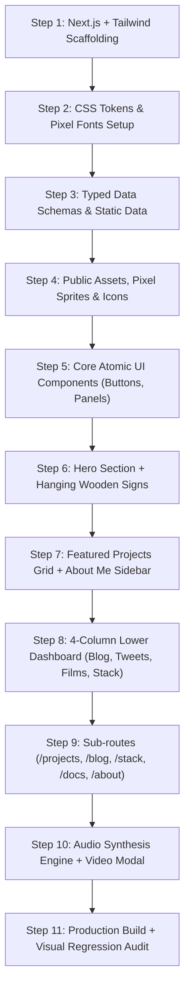

# Phase 8: Antigravity Autonomous Implementation Plan
> **Document ID:** AGENT-PHASE-08  
> **Target Project:** Manish.dev — The Builder's World  
> **Status:** Approved Baseline  
> **Target Engine:** Antigravity / Gemini 3.8 Flash  

---

## 8.1 Implementation Workflow Pipeline



---

## 8.2 Step-by-Step Execution Playbook

### Step 1: Framework Scaffolding
- Execute:
  ```powershell
  npx -y create-next-app@latest ./ --typescript --tailwind --eslint --app --src-dir=false --import-alias="@/*" --use-npm
  ```
- Configure `next.config.mjs` for WebP image optimization and SVG imports.

### Step 2: Styling & Typography Foundation
- Update `app/layout.tsx` to load Google Fonts:
  - `Pixelify Sans` (Display/Headings)
  - `Inter` (Body text)
  - `Geist Mono` (Code & Badges)
- Inject all CSS design tokens and Minecraft bevel classes into `app/globals.css`.
- Update `tailwind.config.ts` to include custom colors (`mc-green`, `mc-oak`, `mc-charcoal`, `mc-gold`).

### Step 3: Typed Data Scaffolding
- Create `data/projects.ts`: Locus, CohortX, Smart Fan (IoT), 3D Portfolio.
- Create `data/blog.ts`: How I Built Locus, Setting Up Next.js + Neon Postgres, IoT Journey.
- Create `data/tweets.ts`: 3 real shipping updates with timestamps.
- Create `data/films.ts`: Locus Demo (12 min), CohortX (15 min), Smart Fan (8 min).
- Create `data/stack.ts`: 15 authentic technology records with categories and proficiency.

### Step 4: Asset Generation & Static Wiring
- Place SVG icons for navigation and stack in `public/icons/`.
- Generate or place WebP visual artwork for hero background, character, and project covers in `public/images/`.

### Step 5: Core UI Primitive Components
- `components/ui/McPanel.tsx`: Reusable dark oak bordered container.
- `components/ui/McButton.tsx`: Beveled primary (emerald) and secondary (wood) button with tactile press states.
- `components/ui/Navbar.tsx`: Fixed top bar with pixel icons, active indicator, and "Let's Connect" CTA.
- `components/ui/Footer.tsx`: Dark oak footer with social channels, resume link, and copyright.

### Step 6: Home Hero & Hanging Wooden Signs
- `components/home/HeroSection.tsx`: Panoramic twilight scenery, seated character graphic, bold 3D "Manish Kumar" header, and dual CTA buttons.
- `components/home/HangingSigns.tsx`: 5 wood signboards linked by chain graphics with gentle CSS sway animation.

### Step 7: Middle Dashboard (Projects + Profile)
- `components/home/FeaturedProjects.tsx`: 3/4 width container holding 4 project cards with 16:9 covers, tags, and golden arrow actions.
- `components/home/AboutMePanel.tsx`: 1/4 width sidebar with Manish avatar, bio, 3 stat slots (`22 Years`, `CSE (IoT) NIET`, `India`), and "More About Me ->" button.

### Step 8: Lower 4-Column Balanced Grid
- `components/home/LatestBlogPanel.tsx`: 3 article previews with thumbnails and publication dates.
- `components/home/LatestTweetsPanel.tsx`: 3 short thoughts with pixel bird icon and timestamps.
- `components/home/FilmsPanel.tsx`: 3 video cards with play overlay and duration badges.
- `components/home/TechStackPanel.tsx`: 5x3 inventory slot matrix with interactive hover tooltips.

### Step 9: Sub-routes & Deep Case Studies
- `/projects/[slug]`: Deep technical case study page with architecture diagrams and hardware pinout.
- `/blog/[slug]`: Reader experience with code blocks and table of contents.
- `/stack`: Full interactive inventory room with category filtering.
- `/about`: Complete personal bio, education timeline, and resume view.

### Step 10: Audio Synthesis & Video Modal
- `lib/SoundService.ts`: Zero-dependency Web Audio API sound generator for button clicks and slot pops.
- `components/modals/VideoModal.tsx`: Accessible video player modal.

### Step 11: Build Verification & Visual Polish
- Execute `npm run build` to verify zero TypeScript errors, lint issues, or broken links.
- Run dev server (`npm run dev`) and test responsiveness across desktop (1440px), tablet (1024px), and mobile (390px).
