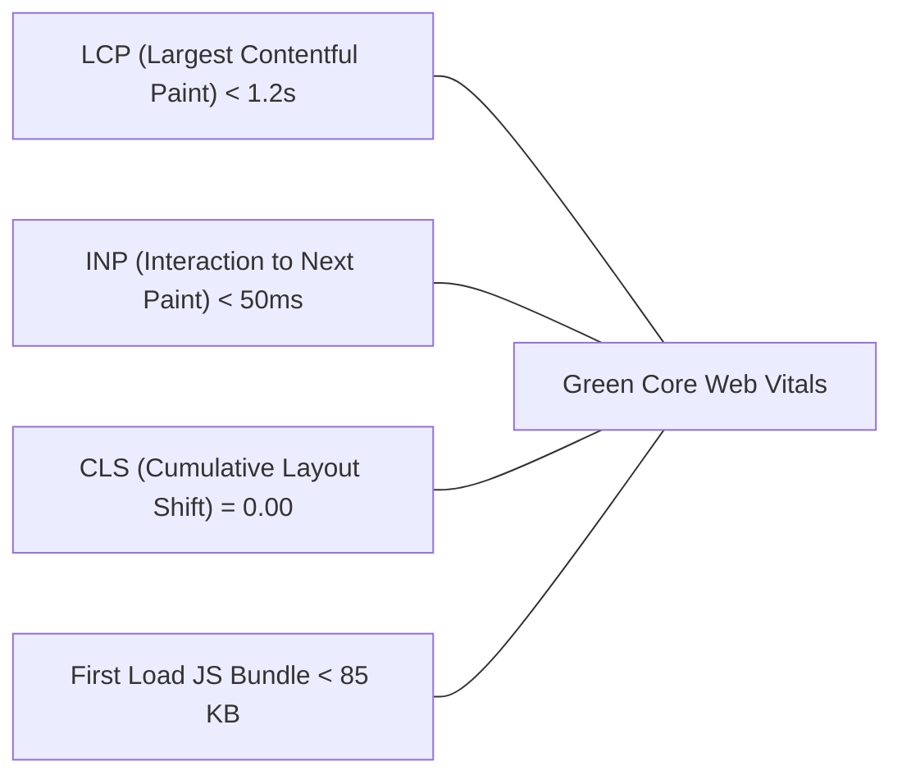

# Phase 9: Quality Assurance, Visual Comparison & Acceptance Sign-Off
> **Document ID:** AGENT-PHASE-09  
> **Target Project:** Manish.dev — The Builder's World  
> **Status:** Approved Baseline  
> **Target Engine:** Antigravity / Gemini 3.8 Flash  

---

## 9.1 Visual Comparison Audit (Reference vs. Implementation)

Every element from the reference screenshot must be verified against the running application:

| Section | Target Visual in Screenshot | Verification Criteria | Status Check |
| :--- | :--- | :--- | :--- |
| **Top Navbar** | Dark oak beveled bar, `<Manish.dev>` brand, 8 icon links, emerald CTA button. | Fixed top position, gold brackets in brand, 16x16 pixel icons, active indicator line. | [ ] |
| **Hero Background** | Twilight indigo sky, setting square sun on right, cliffs, cabin with warm windows, waterfall, distant floating island. | 16:9 responsive panoramic background, high pixel clarity, dark gradient behind text. | [ ] |
| **Hero Character** | Manish in black hoodie sitting on cliff edge with dangling legs, warm lantern beside him. | Pixel art sprite correctly positioned on the left cliff edge. | [ ] |
| **Hero Typography** | "Hey, I'm" / "Manish Kumar" in large 3D extruded green text / "B.Tech CSE (IoT) @ NIET". | Pixelify Sans font, 3D text-shadow (`#1e7a33`), high contrast on dark sky. | [ ] |
| **Hero CTA Row** | Creeper green button `[creeper] View My Work ->` + Oak button `[book] Read My Blog`. | Exact color matching (`#36C653` / `#493421`), bevel box-shadows, tactile press. | [ ] |
| **Hanging Signs** | 5 wooden signboards connected by iron chains hanging on the right side of the hero. | 5 correct labels, iron chain graphics, subtle idle sway, hover displacement. | [ ] |
| **Featured Projects**| 3/4 width dark oak panel with 4 cards: Locus, CohortX, Smart Fan, 3D Portfolio. | 16:9 covers, project titles, subtitles, tech pills, yellow arrow actions. | [ ] |
| **About Me Panel** | 1/4 width sidebar with avatar, bio, 3 stat boxes (`22 Yrs`, `CSE NIET`, `India`), green CTA. | Exact stat box values, rounded bevel, full-width `More About Me ->` button. | [ ] |
| **Blog Posts Panel** | 3 rows with thumbnails, titles, and dates (`Oct 20`, `Oct 12`, `Oct 05`). | Clean typography, dark inner surface, "View All ->" link in header. | [ ] |
| **Tweets Panel** | 3 rows with pixel bird icon, short thoughts, and timestamps (`2h`, `1d`, `3d`). | Relative time badges, clean readability, linkable cards. | [ ] |
| **Films Panel** | 3 video cards with play icon overlays, titles, subtitles, and duration tags. | `12 min`, `15 min`, `8 min` duration pills, play button overlay hover effect. | [ ] |
| **Tech Stack Panel**| Crafting table icon + 5x3 authentic inventory slot grid with 15 technology icons. | 5 columns x 3 rows, dark slot insets, scale-up hover with Minecraft lore tooltip. | [ ] |

---

## 9.2 Performance Budgets & Core Web Vitals



### Performance Standards:
1. **Lighthouse Score:** 95+ in Performance, Accessibility, Best Practices, and SEO.
2. **Zero Layout Shift (CLS = 0):** All images and panels declare explicit aspect-ratio and dimensions.
3. **No Unoptimized Media:** All scenery compressed into WebP with lossy quality 85–90; SVGs minified.
4. **Font Loading:** Google Fonts loaded with `display: swap` to prevent FOIT (Flash of Invisible Text).

---

## 9.3 Accessibility (a11y) Verification

- **Contrast Ratios:**
  - White headers on charcoal panels: `15.2:1` (Exceeds WCAG AAA standard of 7:1).
  - Cream body text on inner cards: `8.4:1` (Exceeds WCAG AAA).
  - Dark ink text on green button: `6.1:1` (Exceeds WCAG AA standard of 4.5:1).
- **Keyboard Navigation:** Every link, card, and interactive sign is accessible via `Tab` key, displaying a golden outline.
- **Screen Reader Support:** Semantic HTML tags (`<header>`, `<main>`, `<nav>`, `<section>`, `<article>`, `<aside>`, `<footer>`).

---

## 9.4 Final Acceptance Checklist

```markdown
- [ ] Framework boots cleanly with zero errors on `npm run dev`
- [ ] Production build passes with zero lint or type errors on `npm run build`
- [ ] All 8 navigation links route to functional pages or anchors
- [ ] Sound toggle turns button click audio on/off cleanly with state saved in localStorage
- [ ] Hovering over Tech Stack slots renders authentic Minecraft purple tooltips
- [ ] Video cards open interactive playback dialog with smooth transition
- [ ] Responsive design verified on Mobile (375px), Tablet (768px), and Desktop (1440px)
- [ ] Verified resume download button works and provides clear developer credentials
```
